<div align="center">

# DeployForge AI

**An enterprise platform for forward-deployed engineers: turn customer requirements into secure, deployable AI-powered solutions.**

[](https://github.com/shiva-sripelly/DeployForge-AI/actions/workflows/ci.yml)


[**Live demo**](https://deploy-forge-ai.vercel.app) ·
[**API health**](https://deployforge-api-jeuo.onrender.com/api/v1/health/ready) ·
[Architecture](docs/architecture.md) ·
[Deployment guide](docs/deployment/CLOUD_DEPLOYMENT.md)

</div>

---

## Overview

DeployForge AI is being built in phases into a platform where engineering teams manage
customer engagements end to end: from requirements, through solution design and AI agents, to
production operations.

The project has completed **Phase 1 (enterprise application foundation)** and **Phase 1.5
(public cloud deployment and CI/CD)**:

- A multi-tenant FastAPI backend with role-based, tenant-aware authorization, an audit trail,
  PostgreSQL with Alembic migrations, and structured logging.
- A React + TypeScript console with a light/dark design system, connected to the API.
- A production deployment on Vercel, Render and Supabase, with a security-gated CI pipeline.

> **Scope note.** The AI capabilities (Solution Architect, Agent Studio, workflow engine,
> integrations, deployments and incidents) are **planned, not implemented**. Their pages in the
> console describe the roadmap and deliberately show no data. See the [Roadmap](#development-roadmap).

### Key features

| Area | What is implemented |
| --- | --- |
| **Multi-tenancy** | Organizations (tenants) and workspaces, with organization roles (owner, admin, member, viewer) and workspace roles (admin, editor, viewer) |
| **Authorization** | JWT bearer authentication on every tenant endpoint and role checks in the service layer. Cross-tenant access returns `404`, so other tenants' IDs cannot be probed. |
| **Database-level isolation** | Composite foreign keys keep workspace memberships within one organization. Row-level security is enabled on every table. |
| **Audit trail** | Organization and workspace creation and token issuance are written in the same transaction as the change |
| **Production API** | Versioned REST (`/api/v1`), liveness and readiness probes, a consistent error envelope, request IDs and pagination |
| **Enterprise console** | Responsive dashboard, customers, workspaces (list, create, detail), monitoring and settings; light, dark and system themes |
| **Public demo mode** | A read-only build with synthetic data. Development sign-in code is removed at compile time. |
| **Operations** | Docker Compose, structured JSON logs, fail-safe production configuration, a five-job CI pipeline |

In the console, **Customers** maps to organizations: each customer is an isolated tenant, and
each engagement or solution for that customer is a **workspace**.

---

## Live deployment

| Component | URL | Hosting |
| --- | --- | --- |
| **Web application** (public demo) | <https://deploy-forge-ai.vercel.app> | Vercel |
| **Backend API** | <https://deployforge-api-jeuo.onrender.com> | Render (Docker) |
| Liveness probe | [`/api/v1/health/live`](https://deployforge-api-jeuo.onrender.com/api/v1/health/live) | |
| Readiness probe (checks the database) | [`/api/v1/health/ready`](https://deployforge-api-jeuo.onrender.com/api/v1/health/ready) | |
| Database | Supabase PostgreSQL (private; reached only by the API, over TLS) | Supabase |

**How the public demo works:**

- **Why read-only.** Phase 1 ships only development authentication, so the public site runs as
  a read-only demo with synthetic data.
- **What is live.** The *platform status* indicators are real calls from your browser to the
  Render API, which checks Supabase.
- **What the API allows.** Every business endpoint rejects anonymous requests with `401`.
- **Cold starts.** The API runs on a free instance that sleeps when idle, so the first request
  can take about a minute.

---

## Screenshots

All screenshots are captured from the live public demo. Data shown is synthetic.

| Enterprise overview (light) | Enterprise overview (dark) |
| :---: | :---: |
| 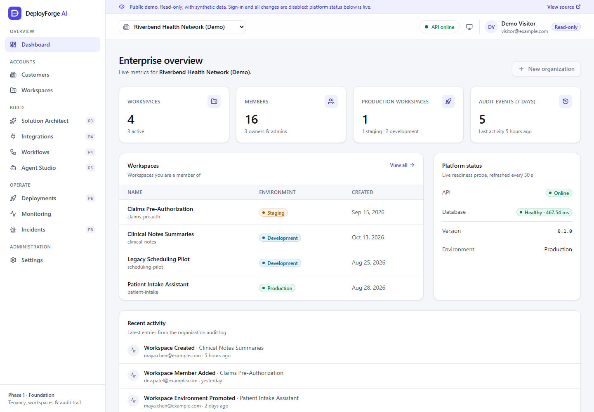 | 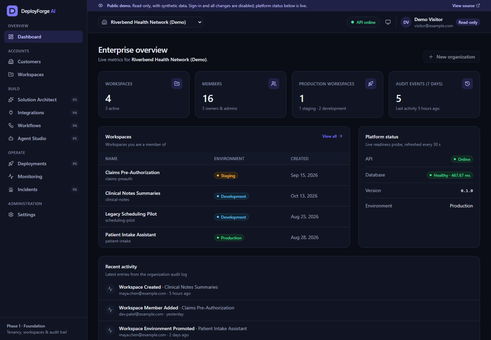 |

| Workspaces | Workspace detail |
| :---: | :---: |
| 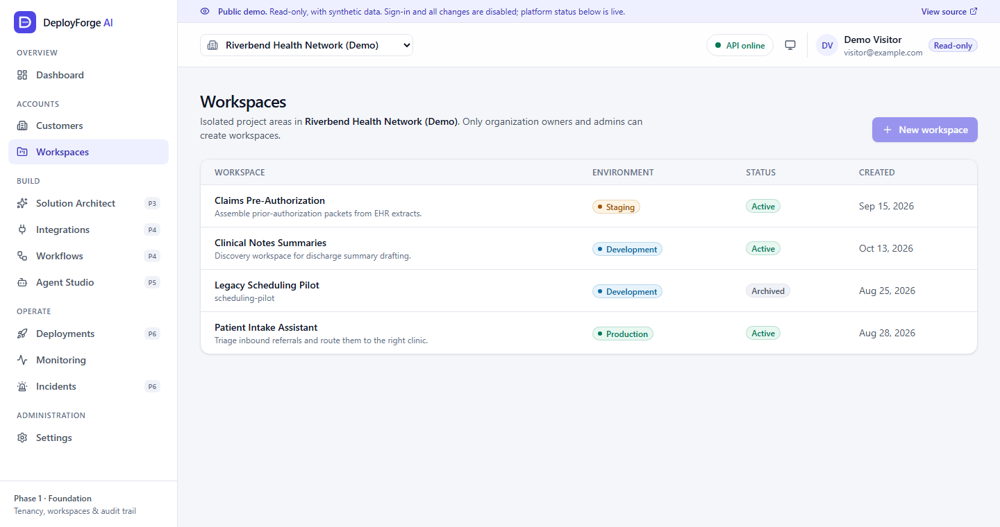 | 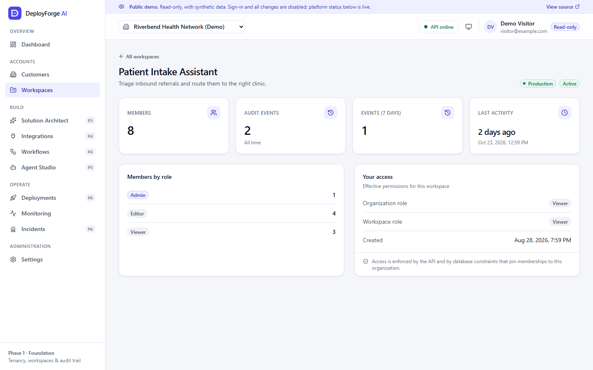 |

| Live platform monitoring | Roadmap placeholder (Agent Studio) | Narrow viewport (500 px) |
| :---: | :---: | :---: |
| 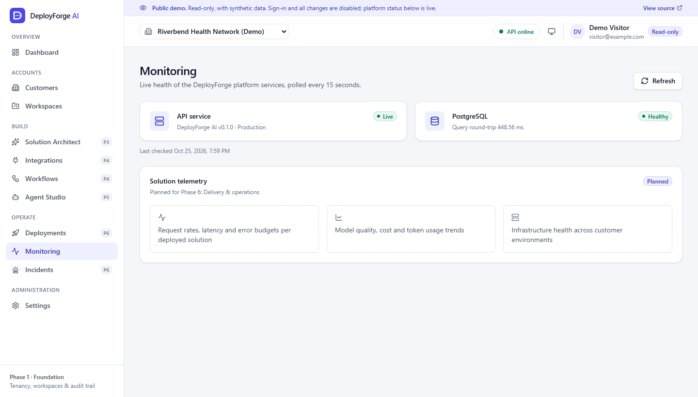 | 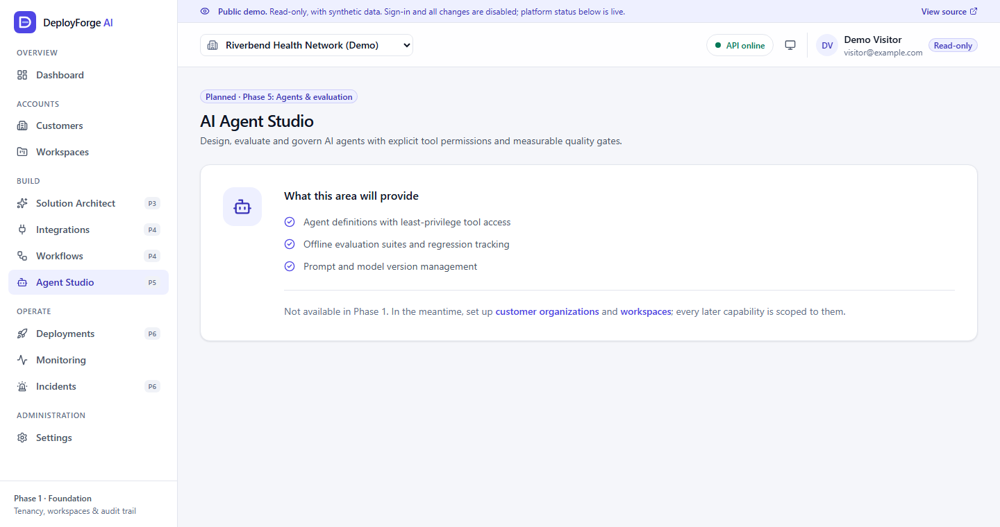 | 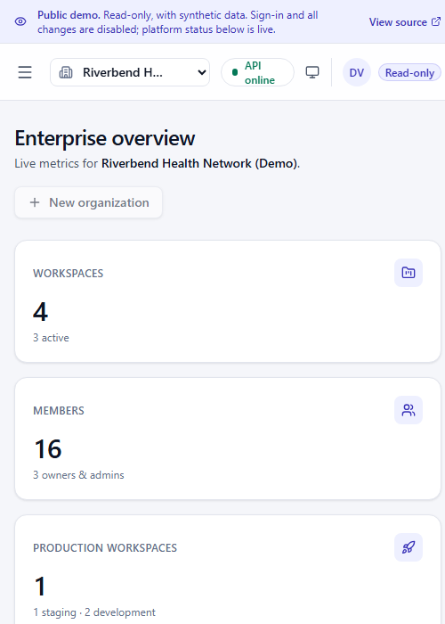 |

---

## Technology stack

| Layer | Technologies |
| --- | --- |
| **Frontend** | React 19, TypeScript (strict), Vite, Tailwind CSS v4 (CSS-variable design tokens), React Router, TanStack Query, Axios, Lucide React |
| **Backend** | Python 3.12, FastAPI, Pydantic v2 and pydantic-settings, SQLAlchemy 2.x, Alembic, psycopg 3, PyJWT, Uvicorn |
| **Database** | PostgreSQL 17 locally; Supabase PostgreSQL (Supavisor session pooler, TLS) in production |
| **Testing** | Pytest against real PostgreSQL, Vitest, React Testing Library, MSW, Ruff, ESLint |
| **Infrastructure** | Docker (non-root images), Docker Compose, nginx (unprivileged), GitHub Actions, Vercel, Render, Supabase |

---

## System architecture

### Deployment architecture

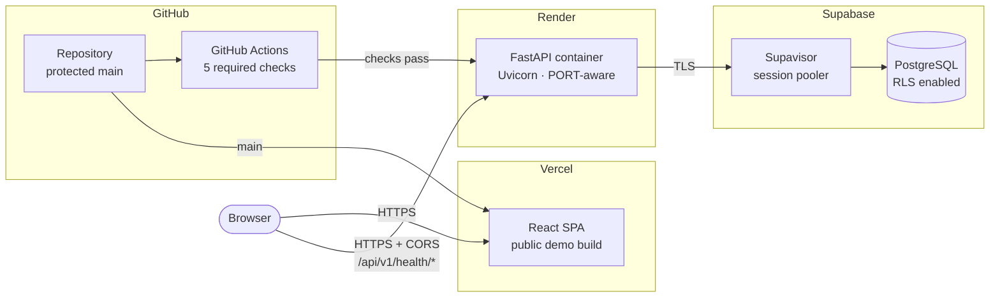

### Local architecture (Docker Compose)

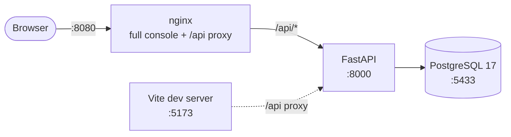

All local ports bind to `127.0.0.1`. In both environments the browser uses a single API base
path, `/api/v1`. Locally it is proxied same-origin by nginx or Vite; in production it is called
cross-origin with an explicit CORS allow-list.

### Frontend architecture

- **Data layer.** Typed endpoint functions and TanStack Query hooks
  ([`src/api/`](frontend/src/api)). Axios errors are normalized into an `ApiError` that mirrors
  the backend error envelope. Only network errors and `5xx` responses are retried.
- **State and context.** Providers for identity, theme and the active organization
  ([`src/providers/`](frontend/src/providers)).
- **Design system.** Accessible primitives such as Button, Card, Badge, Dialog (native
  `<dialog>`), form fields with ARIA wiring, Table, StatCard, and empty, error and loading
  states ([`src/components/ui/`](frontend/src/components/ui)). All colors come from
  light and dark CSS-variable tokens ([`src/styles/index.css`](frontend/src/styles/index.css)).
- **Two builds from one codebase:**
  - **Full console** (`npm run build`): development sign-in plus the live API.
  - **Public demo** (`npm run build:demo`): built with the compile-time flag
    `__DEMO_MODE__`, the same pages render synthetic data
    ([`src/demo/`](frontend/src/demo)), and the sign-in and token code is removed from the
    bundle.
- **Build-time guards.** Production builds reject localhost, `http://`, or a malformed API URL.
  A Content-Security-Policy is injected, scoped to the API origin.

### Backend architecture

A modular monolith with clear layers:

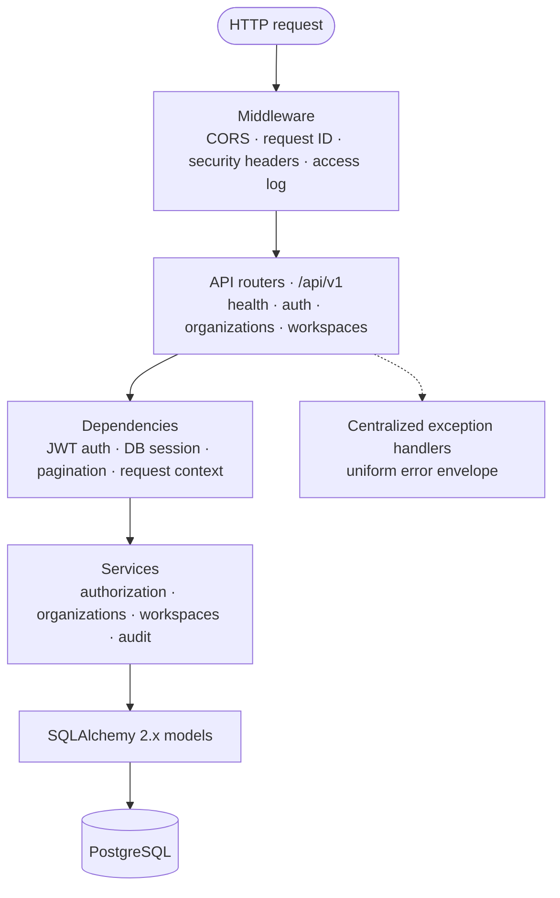

- **Configuration** ([`app/core/config.py`](backend/app/core/config.py)) is validated at
  startup. In production the API refuses unsafe settings, and errors never echo secret values.
- **Authorization** ([`app/services/authorization.py`](backend/app/services/authorization.py))
  loads each resource together with the caller's membership in a single query.
- **Audit events** are added to the same database session as the change, so both commit or
  neither does.
- **Logging** writes one JSON object per line to stdout, tagged with the request ID.

### Database architecture

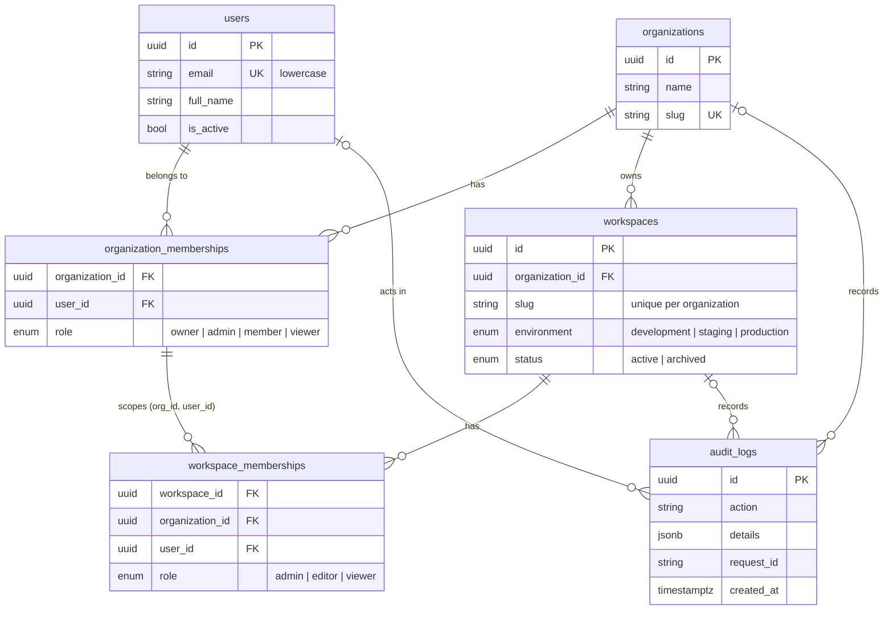

- Every table has UUID primary keys and `timestamptz` timestamps set by the database.
  Constraints and indexes are named deterministically.
- **Composite foreign keys** on `workspace_memberships` make it impossible for the database to
  store a membership in another tenant's workspace, or for a non-member of the organization.
- Audit rows keep their history when the actor or resource is deleted (`ON DELETE SET NULL`).
- **Row-level security** (migration `0002`) denies all rows to non-owner roles, such as the
  roles behind Supabase's public REST API. The API connects as the table owner.

Full design notes, including the authorization matrix: [docs/architecture.md](docs/architecture.md).

---

## Getting started

### Option A: Docker Compose (recommended)

Prerequisites: Docker with Compose v2.

```bash
git clone https://github.com/shiva-sripelly/DeployForge-AI.git
cd DeployForge-AI
cp .env.example .env          # local-development placeholders only
docker compose up -d --build
```

| Service | URL |
| --- | --- |
| Web console | http://localhost:8080 |
| API | http://localhost:8000/api/v1 |
| Interactive API docs (OpenAPI) | http://localhost:8000/api/docs (disabled in production) |
| PostgreSQL | `127.0.0.1:5433` (user/db `deployforge`) |

On startup the backend validates configuration and applies migrations. With
`SEED_DEV_DATA=true` (the default in `.env.example`) it also creates a sample tenant and three
development accounts:

| Account | Access |
| --- | --- |
| `admin@deployforge.dev` | Owner of *Northwind Health*, admin of both workspaces |
| `engineer@deployforge.dev` | Member of *Northwind Health*, editor of one workspace only |
| `outsider@deployforge.dev` | No memberships: demonstrates tenant isolation |

These accounts have no passwords. They can obtain tokens only through the development token
endpoint, which is local-only and refused by the API in production.

```bash
docker compose ps                         # service status and health
docker compose logs -f backend            # structured JSON logs
docker compose exec backend alembic current
docker compose down                       # stop (data persists in the postgres_data volume)
```

### Option B: Run the services directly

Start PostgreSQL first (for example, `docker compose up -d db`).

**Backend** (Python 3.12+):

```bash
cd backend
python -m venv .venv
source .venv/bin/activate              # Windows: .venv\Scripts\activate
pip install -r requirements-dev.txt
cp .env.example .env
alembic upgrade head
python -m app.scripts.seed_dev         # optional development data
uvicorn --factory app.main:create_app --reload --port 8000
```

**Frontend** (Node.js 22.12+):

```bash
cd frontend
npm ci
npm run dev                            # http://localhost:5173 (proxies /api to :8000)
```

> Use `127.0.0.1` rather than `localhost` in local database URLs. On some systems
> `localhost` resolves to IPv6 first and stalls, because Docker publishes the port on IPv4 only.

### Database migrations

```bash
cd backend
alembic upgrade head                                  # apply all migrations
alembic current                                       # show the applied revision
alembic revision --autogenerate -m "describe change"  # generate after editing models (then review)
```

CI fails if the models and migrations drift apart, and it checks that a full downgrade and
upgrade round trip works. New tables must enable row-level security, which a test enforces.

---

## Environment variables

Configuration comes entirely from environment variables. **No secrets are committed.** The
`.env.example` files contain local placeholders only, and production secrets are entered in the
hosting dashboards.

### Backend

| Variable | Required | Default | Description |
| --- | :-: | --- | --- |
| `ENVIRONMENT` | | `development` | `development`, `test`, `staging` or `production` |
| `DATABASE_URL` | ✅ | — | PostgreSQL URL. `postgresql://` is accepted and mapped to psycopg 3. |
| `JWT_SECRET_KEY` | ✅ | — | Token signing key: 32+ characters, or 48+ random characters in production |
| `CORS_ORIGINS` | | `http://localhost:5173` | Comma-separated allowed origins. Production accepts only explicit `https://` origins. |
| `DEV_AUTH_ENABLED` | | `false` | Enables the development token endpoint. Rejected in production. |
| `ACCESS_TOKEN_EXPIRE_MINUTES` | | `60` | Access token lifetime (5–1440) |
| `DATABASE_SSL_MODE` | prod | — | libpq `sslmode`. Production requires `require`, `verify-ca` or `verify-full`. |
| `DATABASE_SSL_ROOT_CERT` | | — | CA certificate path for `verify-ca` / `verify-full` |
| `DATABASE_POOL_SIZE` / `DATABASE_MAX_OVERFLOW` | | `5` / `10` | Connection pool sizing |
| `DATABASE_POOL_RECYCLE_SECONDS` / `DATABASE_CONNECT_TIMEOUT_SECONDS` | | `1800` / `10` | Connection recycling and connect timeout |
| `DATABASE_DISABLE_PREPARED_STATEMENTS` | | `false` | Set `true` behind transaction-mode poolers |
| `LOG_LEVEL` / `LOG_FORMAT` | | `INFO` / `json` | Log verbosity; `json` or `console` |
| `PORT` | | `8000` | Container listening port (injected by Render) |
| `RUN_MIGRATIONS` / `SEED_DEV_DATA` | | `true` / `false` | Container start-up behavior. Seeding refuses to run in production. |

### Frontend (build time)

| Variable | Description |
| --- | --- |
| `VITE_API_BASE_URL` | API base URL as seen by the browser: `/api/v1` locally, `https://<api-host>/api/v1` for the public demo. Compiled into the bundle, so it is **public**. |
| `VITE_APP_MODE` | `full` (default) or `demo`. Set by [`frontend/.env.demo`](frontend/.env.demo) for the public build. |

Compose-only variables (`POSTGRES_*`, `*_HOST_PORT`) are documented in
[`.env.example`](.env.example). The full production reference is in the
[deployment guide](docs/deployment/CLOUD_DEPLOYMENT.md#5-environment-variable-reference).

---

## API documentation

Interactive OpenAPI documentation is served at `/api/docs` in non-production environments.
It is intentionally disabled in production.

| Method | Endpoint | Access |
| --- | --- | --- |
| `GET` | `/api/v1/health/live` | Public: process liveness |
| `GET` | `/api/v1/health/ready` | Public: database readiness (`503` when not ready) |
| `POST` | `/api/v1/auth/dev/token` | Development only: token for an existing, active account (absent in production) |
| `GET` | `/api/v1/auth/me` | Authenticated |
| `POST` | `/api/v1/organizations` | Authenticated; the caller becomes owner |
| `GET` | `/api/v1/organizations` | Authenticated; only organizations the caller belongs to |
| `GET` | `/api/v1/organizations/{id}` | Organization member |
| `GET` | `/api/v1/organizations/{id}/stats` | Organization member |
| `GET` | `/api/v1/organizations/{id}/audit-logs` | Organization owner or admin |
| `POST` | `/api/v1/organizations/{id}/workspaces` | Organization owner or admin |
| `GET` | `/api/v1/organizations/{id}/workspaces` | Owners and admins see all workspaces; others see their own |
| `GET` | `/api/v1/workspaces/{id}` | Organization owner/admin, or workspace member |
| `GET` | `/api/v1/workspaces/{id}/stats` | Organization owner/admin, or workspace member |

List endpoints accept `limit` (1–100) and `offset`. Every response includes an `X-Request-ID`
header. Errors use one envelope:

```json
{ "error": { "code": "permission_denied", "message": "...", "details": null, "request_id": "..." } }
```

Example against the live API:

```bash
curl https://deployforge-api-jeuo.onrender.com/api/v1/health/ready
# {"status":"ready","version":"0.1.0","environment":"production","checks":{"database":{"status":"ok",...}}}

curl -i https://deployforge-api-jeuo.onrender.com/api/v1/organizations
# HTTP/1.1 401 Unauthorized
```

---

## Security

### Application security

- **Authentication.** JWT signature, expiry, issuer and audience are verified, and only the
  configured algorithm is accepted (unsigned `alg=none` tokens are rejected). The user must
  exist and be active.
- **Authorization.**
  - Role checks run in the service layer.
  - Resources outside the caller's tenants return `404` to prevent enumeration.
  - A `403` response lists the roles that would be required.
- **Input validation.** Pydantic v2 schemas reject unknown fields. Slugs, lengths, enums and
  pagination bounds are enforced.
- **Error handling.** The API returns a generic `500` with no internal details. Configuration
  errors name the variable but never echo its value.
- **Headers.** The API sets `nosniff`, `X-Frame-Options: DENY` and `Cache-Control: no-store`.
  The frontend serves a strict Content-Security-Policy.

### Deployment security

- **Fail-safe production configuration.** The API refuses to start if any of these hold:
  - `JWT_SECRET_KEY` or `DATABASE_URL` is missing, or the key is weak or a placeholder.
  - Development auth is enabled.
  - `CORS_ORIGINS` contains `*`, `http://` or localhost origins.
  - The database connection is not TLS-encrypted.
- **No authentication bypass in production.** The development token endpoint is not mounted,
  so no token can be issued and every protected endpoint returns `401`.
- **Public demo boundary.**
  - The demo bundle contains no sign-in code, seeded accounts or token handling, and a CI bundle
    scan enforces this.
  - The demo never calls protected endpoints.
  - The backend enforces access regardless of the frontend.
- **Database.**
  - TLS is required in production (`verify-full` supported).
  - Row-level security is enabled on every table.
  - Credentials live only in Render's environment, never in the frontend or the repository.
- **Containers.** Images run as non-root users with minimal runtime layers. Local ports bind
  to loopback only.

### CI/CD security gates

Every pull request and every push to `main` runs [five jobs](.github/workflows/ci.yml):

| Job | What it checks |
| --- | --- |
| **Security configuration** | No committed env files or credential-like strings; safe Render, Vercel and Compose settings ([script](scripts/ci/check_security_config.py)) |
| **Backend** | Ruff lint and format, migrations on a fresh database, seed idempotency, pytest with coverage against PostgreSQL |
| **Frontend** | ESLint, TypeScript, the full-console and demo test suites, both production builds, public-bundle scan |
| **Backend container** | The real image refuses unsafe production config, binds `PORT`, and rejects anonymous access ([script](scripts/ci/container_smoke_test.sh)) |
| **Docker Compose** | Local images build |

Render is configured to deploy `main` only after these checks pass, and Vercel builds production only from
`main`. Setup, verification, troubleshooting and rollback procedures are in
[docs/deployment/CLOUD_DEPLOYMENT.md](docs/deployment/CLOUD_DEPLOYMENT.md).

---

## Testing

The backend suite runs against a **real PostgreSQL database**. The schema is built by the
Alembic migrations, and each test runs in a rolled-back transaction.

```bash
docker compose up -d db
cd backend
pytest --cov=app
ruff check . && ruff format --check .
```

Coverage areas:

- Health and readiness, including a database outage
- Migration integrity, model constraints and tenant-isolation foreign keys
- Request validation
- Authentication edge cases: expired, forged, unsigned and wrong-audience tokens, and inactive
  users
- Role- and tenant-based authorization boundaries
- Production-configuration safety, TLS and connection-pooler options, and row-level security

The frontend uses Vitest, React Testing Library and MSW, with two test projects: `full` (the
console with sign-in) and `demo` (compiled as the public build).

```bash
cd frontend
npm test
npm run lint && npm run typecheck
npm run build && npm run check:bundle
```

---

## Project structure

```
DeployForge-AI/
├── backend/
│   ├── app/
│   │   ├── api/              # Routers (/api/v1) and dependencies: auth, DB session, pagination
│   │   ├── core/             # Settings validation, JSON logging, exceptions, JWT security
│   │   ├── db/               # Engine, sessions, TLS/pool options, declarative base
│   │   ├── models/           # SQLAlchemy models: users, organizations, workspaces, memberships, audit logs
│   │   ├── schemas/          # Pydantic request/response models
│   │   ├── services/         # Business logic: authorization, organizations, workspaces, audit
│   │   ├── scripts/          # Development seed data (refuses to run in production)
│   │   ├── middleware.py     # Request IDs, security headers, access logging
│   │   └── main.py           # FastAPI application factory
│   ├── alembic/versions/     # 0001 initial schema · 0002 row-level security
│   ├── tests/                # Pytest suite (real PostgreSQL)
│   ├── Dockerfile            # Multi-stage, non-root, PORT-aware image
│   └── docker-entrypoint.sh  # Validate config → migrate → (seed) → serve
├── frontend/
│   ├── src/
│   │   ├── api/              # Typed endpoints and TanStack Query hooks
│   │   ├── components/       # Design system (ui/) and app shell (layout/)
│   │   ├── demo/             # Public demo: synthetic data, read-only adapter, demo identity
│   │   ├── features/         # Create dialogs, roadmap placeholders
│   │   ├── pages/            # Route screens
│   │   ├── providers/        # Auth, theme, active organization
│   │   └── styles/           # Tailwind v4 design tokens (light/dark)
│   ├── config/               # Build-time API URL and CSP checks
│   ├── scripts/              # Production bundle scanner
│   ├── vercel.json           # SPA fallback, security headers, demo build command
│   └── Dockerfile, nginx.conf
├── docs/
│   ├── architecture.md
│   ├── deployment/CLOUD_DEPLOYMENT.md
│   └── assets/screenshots/
├── scripts/ci/               # Security-config check, container smoke test
├── .github/workflows/ci.yml  # Five-job CI pipeline
├── docker-compose.yml        # Local stack (loopback-only ports)
└── render.yaml               # Render Blueprint (secrets via dashboard)
```

---

## Development roadmap

| Phase | Status | Theme | Scope |
| --- | :-: | --- | --- |
| **1 · Foundation** | ✅ Complete | Platform core | Multi-tenant organizations and workspaces, RBAC, audit trail, versioned API, enterprise console, Docker, CI |
| **1.5 · Cloud deployment** | ✅ Complete | Ship publicly | Vercel, Render and Supabase deployment, read-only public demo, TLS and RLS hardening, security-gated CI/CD |
| **2 · Identity & access** | Planned | Enterprise auth | OIDC/SAML SSO, invitations, role management UI, API keys, token revocation, tenant-scoped RLS policies |
| **3 · Requirements intelligence** | Planned | AI Solution Architect | Requirement capture, generated reference architectures, risk and compliance checklists, human approval |
| **4 · Integrations & workflows** | Planned | Connect and orchestrate | Connector catalog, external secrets management, versioned workflows with approval steps |
| **5 · Agents & evaluation** | Planned | AI Agent Studio | Least-privilege agent tools, evaluation suites, prompt and model versioning |
| **6 · Delivery & operations** | Planned | Ship and run | Environment promotion, rollbacks, solution telemetry, incident management |

### Known limitations

- **Development-grade authentication.** There are no passwords, SSO or MFA yet. Locally, tokens
  come from the dev endpoint for seeded accounts; production has no sign-in until Phase 2.
- **No membership management API.** Inviting members, changing roles, archiving workspaces and
  deleting organizations are not exposed yet.
- **Stateless tokens.** Access tokens cannot be revoked before they expire (60 minutes by
  default).
- **Audit log immutability.** The log is append-only by convention; the database does not yet
  enforce it.
- **No API rate limiting.** In production, the only public endpoints are the health checks.
- **Free-tier hosting.** The API sleeps after inactivity, and Supabase pauses inactive free
  projects.

---

<div align="center">

Built with FastAPI, React and PostgreSQL ·
[Live demo](https://deploy-forge-ai.vercel.app) ·
[Report an issue](https://github.com/shiva-sripelly/DeployForge-AI/issues)

</div>
